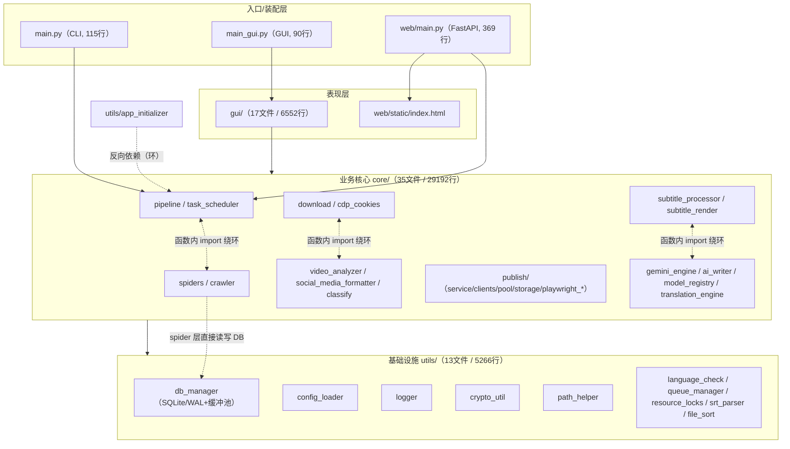

# 每日架构代码审核报告 — 2026-10-08（首次基线审核）

> 审核对象：`D:\Ideas\VideoCrawler\Vc`（Python 多语种视频爬虫 / 下载 / 字幕翻译 / AI 文案 / 多平台发布工具，PySide6 GUI + FastAPI Web 双入口）
> 审核日期：2026-10-08（周四）
> 审核性质：定时任务「每日架构代码审核」首次基线审核。历史档案 `audit_history.md` 在此之前为空，故本次 **55 条发现均为新发现**，编号 `AUDIT-0001` 起。
> 约束声明：本次为**只读审核**，未修改、移动、删除任何业务代码或用户文件；仅新增本报告与 `audit_history.md` 登记。

---

## 一、执行摘要

本次审核覆盖 72 个第一方 Python 文件、约 **41,976 行**代码（不含 `bin/`、`tools/`、`models/` 下第三方与二进制），从架构分层、模块耦合、超大文件、并发安全、资源释放、安全基线、配置与数据层、打包测试、根目录卫生 9 个维度进行了系统检查。

**整体评价：功能完整、分层方向基本正确，但工程基线（尤其是安全与版本管理）存在明显缺口。**

- **值得肯定的部分**
  - 分层方向正确：`gui/web → core → utils` 单向依赖主干清晰，GUI 与 Web 均复用 `core` 业务层，未出现两套并行的业务实现（但流水线编排存在重复，见 AUDIT-0034）。
  - 路径适配细致：`utils/path_helper.py` 统一处理开发态、PyInstaller、Nuitka 三种运行环境的资源定位。
  - 数据层基础规范：SQL 基本使用参数化占位（`?`），`schema.sql` 外键、CHECK、索引设计完整；连接开启了 WAL、`busy_timeout`、`foreign_keys=ON`。
  - 日志分文件输出并配置了轮转（10MB / 保留 7 天 / zip 压缩）。

- **需要优先处理的问题（按风险排序）**
  1. **安全基线失守（最紧急）**：`config.yaml` 被 git 跟踪，其中含多个**明文付费 API Key 与云厂商 AK/SK**（AUDIT-0001）；`crypto_util.py` 的加密密钥由机器名 + 硬编码 salt 派生，属"混淆"而非加密（AUDIT-0002）；Web 端 API Key 走 URL query 并明文打印进日志（AUDIT-0012）。
  2. **版本管理错位**：git 仓库跟踪了 37 个 output 成品、84 个 ffmpeg 第三方文件，而 `gui/`、`web/`、`core/publish/`、`core/pipeline.py` 等**最新第一方代码反而未纳入版本控制**（AUDIT-0004）。
  3. **数据层无 WAL checkpoint**：WAL 已达 2.17MB、是主库的 15 倍，且内存缓冲池在崩溃时会丢数据、存在读写不一致窗口（AUDIT-0003）。
  4. **超大文件集中**：4 个核心文件超过 2000 行，最大 `video_analyzer.py` 达 5683 行，其中单方法硬编码约 3800 行语言数据，且两份语言数据复制后分叉（AUDIT-0013 ~ AUDIT-0016）。
  5. **资源生命周期管理薄弱**：playwright 浏览器、线程池、子进程在异常路径与关窗时不释放（AUDIT-0007/0008/0011）。
  6. **零自动化测试**：`tests/` 目录为空，基建模块无回归保护（AUDIT-0041）。

**严重程度分布**：高 16 条、中 26 条、低 13 条，合计 **55 条**。

**建议处理顺序**：① 立即作废并轮换全部泄露密钥、把密钥迁出 `config.yaml`；② 修正 git 跟踪内容并提交新代码；③ 补 WAL checkpoint；④ 补齐关键测试；⑤ 推进超大文件拆分与 core 解耦；⑥ 清理根目录与打包卫生。

---

## 二、架构依赖关系图



**说明**：实线为正常向下依赖；虚线为分层倒置或依赖函数内延迟导入维系的环。

- 主干 `gui/web → core → utils` 方向正确。
- 三处异常：`utils/app_initializer.py` 反向 import `core.task_scheduler`（AUDIT-0040）；core 内部 `task_scheduler↔pipeline`、`download↔classify`、`subtitle_processor↔gemini_engine` 靠函数内 import 绕开循环依赖（AUDIT-0040）；`youtube_spider` 在 spider 层直接读写 DB（AUDIT-0048 记录）。
- 未发现 import 语句层面的直接（模块加载期）循环导入。

---

## 三、新发现优化点（按严重程度排序）

> 每条含：问题 / 证据（文件:行号）/ 影响 / 改进建议。全部行号已经过 Grep 与 Python 双重实测核对。

### 【高严重程度】

### AUDIT-0001 config.yaml 含明文 API Key 与云厂商凭据，且被 git 跟踪
- **涉及文件**：`config.yaml:21`、`:64`、`:101-102`、`:110-111`、`:127`、`:141`、`:153`、`:165`、`:177`
- **问题**：`config.yaml` 是 git 跟踪文件（最近提交 `3219857 feat: 完成28种语言完整支持及UI升级`），但其中直接以明文写入多组可用凭据，并在 `providers:` 列表中重复出现。
- **证据**（键值已全部移除）：
  - `config.yaml:21` `gemini.api_key: <REDACTED>`（Google Gemini）
  - `config.yaml:64` `ai_writer.api_key: <REDACTED>`（智谱 GLM）
  - `config.yaml:101-102` 火山引擎 `appid: <REDACTED>` + `secret: <REDACTED>`（后者仅 base64 编码，非加密）
  - `config.yaml:110-111` 腾讯云 `secret_id: <REDACTED>` + `secret_key: <REDACTED>`
  - `config.yaml:127` Groq `api_key: <REDACTED>`；`:141` free.ai `api_key: <REDACTED>`
  - 同批 Key 在 `providers:` 列表的 `:153`（gemini）、`:165`（glm）、`:177`（groq）再次明文重复。
- **影响**：任何拿到仓库或发行包（`build_gui.bat:83` 会把 config.yaml 复制进 dist）的人都可直接使用这些付费 API 与云账号；腾讯/火山的 AK/SK 泄露可产生实际账单。项目已有 `api_secret.yaml.enc` 加密机制，但仅用于 YouTube Key（`core/spiders/youtube_api_client.py:33`），主力 Key 全部裸奔。
- **改进建议**：
  1. 立即在各平台控制台**作废并轮换**上述全部 Key（git 历史中已留存，仅删除当前文件无效）。
  2. 将 Key 全部迁入 `api_secret.yaml.enc`（经 `crypto_util` 加载），`config.yaml` 只留空串占位。
  3. `git rm --cached config.yaml` 并将其加入 `.gitignore`，改为随包分发 `config.example.yaml` 模板；必要时用 `git filter-repo` 清理历史。
- **处理记录（2026-10-29）**：`config.yaml` 已移出跟踪并加入 `.gitignore`；两个泄漏的完整 Key 所在文件已脱敏；仓库历史已压缩为单一提交，旧提交不再包含任何密钥明文。

### AUDIT-0002 crypto_util 加密密钥由机器名+硬编码 salt 派生，属"混淆"而非加密
- **涉及文件**：`utils/crypto_util.py:54-62`、`:67-68`
- **问题**：加密主密钥由公开可推信息派生，而非真正的密钥托管；异常分支还会随机生成新密钥导致已加密数据永久不可解。
- **证据**：
  - `crypto_util.py:54` `machine_id = platform.node() + os.path.expanduser("~")`，`:55` 对其 sha256 作为种子；
  - `crypto_util.py:60` `salt=b"multilang_video_crawler"`（硬编码）；`:61` `iterations=100000`；
  - `crypto_util.py:67-68` 异常分支直接 `Fernet.generate_key()`。
- **影响**：知道源码 + 机器名/用户目录路径即可重算出同一把 Fernet Key，加密只防"肉眼直接打开"；且加密文件与机器绑定，换机即失效；异常分支触发后历史密文不可解密。
- **改进建议**：salt 改为随机生成并写入本地受保护文件（不入 git），或由用户口令派生（PBKDF2/scrypt）；不要用 `platform.node()+home` 这类可复现输入作为熵源；异常分支禁止静默生成新密钥。

### AUDIT-0003 SQLite 无 WAL checkpoint 策略，内存缓冲池存在丢数据与读写不一致
- **涉及文件**：`utils/db_manager.py:317-326`、`:193-258`（BufferPool）、`:366-391`（yield_to_db）；实测 `data/video_tasks.db`
- **问题**：连接只设置了 `journal_mode=WAL`（:317）、`busy_timeout`（:320）、`synchronous=NORMAL`（:323）、`foreign_keys=ON`（:326），全文无任何 `wal_checkpoint` / `wal_autocheckpoint` 配置；写入先进入内存队列，定时/定量刷盘。
- **证据**：
  - 实测主库 `video_tasks.db` 约 0.14MB（151,552 字节），`video_tasks.db-wal` 2.17MB（2,278,392 字节），shm 0.03MB —— WAL 是主库的 15 倍；
  - `db_manager.py:215-225` 写入先进内存队列，`:227-231` 每 3 秒或满 50 条才 `yield_to_db`；
  - 强一致读（如 `get_video_by_url:589`）依赖手动 `flush_now()`（:644 等处）补偿，而 `count_*`、`get_pending_tasks` 等读路径不补偿。
- **影响**：WAL 无限增长、异常退出后恢复慢；崩溃时最多丢失 3 秒/50 条未落盘数据；存在"刚入队却查不到"的读写一致性窗口。
- **改进建议**：
  1. 在 pragma 段补 `PRAGMA wal_autocheckpoint=1000;`，并在 `shutdown_db()`（:1259）关闭前执行 `PRAGMA wal_checkpoint(TRUNCATE);`；
  2. 关键写后立即 `flush_now()`，强一致读统一"先 flush 再查"；
  3. 立即手动执行一次 `PRAGMA wal_checkpoint(TRUNCATE)` 回收当前 2.17MB。

### AUDIT-0004 git 跟踪内容错位：成品/第三方入库，最新第一方代码未跟踪
- **涉及文件**：`.gitignore:41`、`:46-47`；git index 实测
- **问题**：仓库 170 个跟踪文件中，大量是本不该入库的产物与第三方文件，而真正的新代码未纳入版本控制。
- **证据**：
  - `output/` 被跟踪 37 个文件（`.gitignore:41` 虽有 `output/`，但这些是加规则前已提交的旧文件）；
  - `bin/` 下跟踪 84 个文件 = `bin/ffmpeg/` 42 个 + `bin/ffmpeg-8.1.2-full_build/` 42 个（后者多为 ffmpeg 发布文档，且磁盘上已不存在，为 index 陈旧跟踪）；
  - `git status --porcelain` 显示 `gui/`（17 文件）、`web/`、`scripts/`、`core/publish/`、`core/pipeline.py`、`core/gemini_engine.py`、`main_gui.py`、`build_gui.spec`、`runtime_hook.py` 等均未跟踪。
- **影响**：仓库被成品/第三方文档撑大，却没有保护最新代码；换机或误删后新代码无版本兜底。
- **改进建议**：
  1. `git rm --cached -r output bin/ffmpeg-8.1.2-full_build`（保留磁盘文件）；
  2. `.gitignore` 显式增加 `bin/ffmpeg/`、`bin/ffmpeg-*/`、`bin/nodejs/`、`output/`；
  3. 将未跟踪的第一方代码正式 `git add` 提交。

### AUDIT-0005 硬编码开发者本机 Node 路径，换机即失效
- **涉及文件**：`core/download.py:726`、`core/spiders/youtube_spider.py:137`
- **问题**：探测 Node 时，`shutil.which("node")` 失败后直接兜底到写死的个人机器路径。
- **证据**：
  - `core/download.py:726` `_node_exe = r"C:\Users\cjl\.workbuddy\binaries\node\versions\22.22.2\node.exe"`
  - `core/spiders/youtube_spider.py:137` 同一字符串重复出现。
- **影响**：yt-dlp 新版本解析 YouTube 强依赖 JS runtime；换机后 `_node_exe=None`，YouTube 下载/预探静默降级，表现为大面积 `extract_info` 失败且难排查。
- **改进建议**：兜底路径改为配置项（`config.yaml` 增加 `download.node_path`）或由 `path_helper` 统一解析；至少从环境变量 `NODE_PATH` 读取，禁止写死用户名目录。

### AUDIT-0006 curl_cffi 失败后的 requests 兜底条件写反，异常路径永不触发
- **涉及文件**：`core/crawler.py:200-218`
- **问题**：注释说明"curl_cffi 重试全部失败后降级到 requests 兜底一次"，但触发条件是 `if self._enable_tls_finger and last_exception is None`，而最常见失败路径下 `last_exception` 必非 None。
- **证据**：
  - `core/crawler.py:200-207` `except Exception as e: last_exception = e; … time.sleep(2 ** attempt)`；
  - `core/crawler.py:210` `if self._enable_tls_finger and last_exception is None:`。
- **影响**：真正需要降级时（DNS 失败、连接被拒、TLS 握手失败）降级不生效；仅在"请求未抛异常但返回空响应"的罕见情况下才走 requests，反爬失效时排障方向错误。
- **改进建议**：改为"重试全部耗尽即降级"，去掉 `and last_exception is None`；或用 `fallback_done` 标志保证兜底确实执行一次。

### AUDIT-0007 Pipeline 的 ThreadPoolExecutor 在异常路径不 shutdown，可能挂死进程退出
- **涉及文件**：`core/pipeline.py:512-635`
- **问题**：`run()` 在 try 内创建 `executor` 并提交任务，`executor.shutdown(wait=True)`（:614）只在正常路径可达；异常路径（:628 except）不 shutdown。
- **证据**：
  - `core/pipeline.py:513` `executor = ThreadPoolExecutor(max_workers=config.max_parallel)`；
  - `core/pipeline.py:614` `executor.shutdown(wait=True)`；
  - `core/pipeline.py:628-635` `except … finally: self._running = False`（finally 中不 shutdown）。
- **影响**：ThreadPoolExecutor 的 worker 为非守护线程，下载中抛异常时解释器退出会 join 这些线程，表现为"关了程序进程仍在后台"。
- **改进建议**：用 `with ThreadPoolExecutor(...) as executor:` 包裹整段，或在 finally 中 `executor.shutdown(wait=False, cancel_futures=True)`（Python 3.9+）。

### AUDIT-0008 playwright 浏览器/上下文在 do_upload 异常路径下不关闭
- **涉及文件**：`core/publish/playwright_base.py:122-152`
- **问题**：`_upload_async` 中 `context.close()`（:145）和 `browser.close()`（:146）写在 `do_upload`（:143）之后、`finally` 之外；`do_upload` 抛异常即被跳过。
- **证据**：`core/publish/playwright_base.py:143 success,msg = await self.do_upload(...)` → :145 `await context.close()` → :146 `await browser.close()`；finally（:148-152）仅删除临时 storage 文件。
- **影响**：抖音/小红书/快手上传失败后浏览器进程残留，多次失败后系统中浏览器进程堆积。
- **改进建议**：用 try/finally 或 `async with` 管理 browser/context：
  ```python
  async with async_playwright() as pw:
      browser = await pw.chromium.launch(...)
      try:
          context = await browser.new_context(storage_state=str(storage_file))
          page = await context.new_page()
          success, msg = await self.do_upload(page, video_path, meta)
      finally:
          await context.close()
          await browser.close()
  ```

### AUDIT-0009 ai_writer 守卫逻辑导致 Groq 梯队被 GLM 开关误杀
- **涉及文件**：`core/ai_writer.py:255-257`、`:128-158`、`:872`
- **问题**：`generate_content` 开头的守卫使用 GLM 梯队的 `enabled`/`api_url`，而 Groq 梯队由独立的 `groq_enabled` 控制；只配 Groq 而 GLM 关闭时，函数在 :257 直接返回空串，走不到 Groq 分支。
- **证据**：
  - `core/ai_writer.py:255-257` `if not self._config.enabled or not self._config.api_url: return ""`；
  - `core/ai_writer.py:872` `if self._config.groq_enabled:`（Groq 分支在 `_call_ai_api` 内）。
- **影响**：用户配好 Groq 但 GLM 未开时，AI 文案静默返回空、无任何报错，排查困难。
- **改进建议**：守卫改为 `if not (self._config.groq_enabled or (self._config.enabled and self._config.api_url)): return ""`，或抽出 `_any_tier_enabled()` 属性。

### AUDIT-0010 page_publish 工作线程直接操作 UI 并在子线程弹模态框
- **涉及文件**：`gui/pages/page_publish.py:641-666`
- **问题**：发布任务的 `_work` 闭包运行在 `threading.Thread(daemon=True)` 中，却直接读写控件并弹出模态 `QMessageBox`，不走信号槽。
- **证据**：
  - `page_publish.py:641-643` 进度回调内 `self._progress.setValue(...)`（由 worker 线程触发）；
  - `:652` `setVisible(False)`、`:654` `self._set_status(...)`、`:664` `self._update_publish_btn()`；
  - `:655-663` 直接在 worker 线程调用 `QMessageBox.information/critical`；
  - 对照 `page_recognize.py:326,333`、`api_config_dialog.py:613`（`QMetaObject.invokeMethod(..., QueuedConnection)`）才是正确写法。
- **影响**：Qt 禁止非主线程操作控件；子线程弹模态框在 Windows 上易导致 UI 冻结/死锁、进度条不刷新、偶发崩溃；playwright 上传是长任务，风险窗口大。
- **改进建议**：定义 `_sig_publish_done = Signal(bool, dict)`、`_sig_progress = Signal(int,int)`、`_sig_msg = Signal(str)`，worker 只 emit，所有 UI 操作移到主线程槽。

### AUDIT-0011 MainWindow 无 closeEvent，关窗时子进程与后台线程不清理
- **涉及文件**：`gui/main_window.py`（全文无 `closeEvent`）；`gui/pages/page_subtitle.py:402`；`gui/auto_pipeline.py:155-162`
- **问题**：用户直接点 X 退出时没有任何钩子去 join 线程或 terminate 子进程；仅有手动菜单"强制结束"。
- **证据**：
  - Grep `closeEvent` 全 gui 仅命中 `global_log_panel.py:209`、`widgets/video_preview.py:158`，`main_window.py` 0 命中；
  - `page_subtitle.py:402` `subprocess.run(cmd, capture_output=True, timeout=1800)` 不持有 Popen 句柄，无法 kill；
  - `auto_pipeline.py:157-162` 注释自认超时任务线程"作为 daemon 留在后台"；
  - 所有 worker 均为 `daemon=True`，被强杀时持有的临时文件/资源锁不释放。
- **影响**：关窗后 ffmpeg/浏览器/yt-dlp 残留、文件被占用导致下次下载报锁、孤儿进程越攒越多。
- **改进建议**：重写 `MainWindow.closeEvent`：先 `TaskManager.force_stop()`，对登记的子进程句柄 `Popen.terminate()/kill()`，给 AutoPipeline 加 stop flag，最后 `event.accept()`；ffmpeg 统一改用 `Popen` 并登记。

### AUDIT-0012 Web 端 API Key 走 URL query 且明文入日志，叠加公网隧道暴露
- **涉及文件**：`web/main.py:41`、`:170`、`:367-369`；`web/static/index.html:325,350,371,476,494`；`web/lt.out:1`
- **问题**：FastAPI 虽有 `_auth` 鉴权，但 Key 的传递与暴露面存在硬伤，且目录残留内网穿透产物。
- **证据**：
  - `web/main.py:41` `API_KEY = os.environ.get("VC_WEB_API_KEY") or secrets.token_urlsafe(16)`，重启即变；
  - `:170,367` 把完整 Key `logger.info`/`print` 到日志；
  - 前端所有请求 `fetch('/api/xxx?key=${API_KEY}')`，Key 落入 uvicorn access log、浏览器历史、Referer；
  - `web/lt.out:1` 残留 `https://chilly-moose-agree.loca.lt`（localtunnel 历史公网地址）；
  - `:369` `host="0.0.0.0"` 绑定全部网卡；`:357-360` `/api/stop` 注释自认"没有 cancel 标志，只能标记状态"。
- **影响**：拿到一次带 Key 的 URL 即可远程触发下载/上传（消耗 API 配额、拉起 playwright）；历史随机子域存在被遍历风险；stop 按钮名不副实。
- **改进建议**：① Key 改用 `Authorization: Bearer` 头；② 启动日志只打 Key 前 4 位；③ `lt.out`、`tunnel.*`、`cloudflared.exe` 加入 `.gitignore` 并清理；④ PipelineRunner 增加 cooperative cancel flag 让 `/api/stop` 真正生效。

### AUDIT-0013 video_analyzer.py 5683 行：单方法硬编码约 3800 行语言数据
- **涉及文件**：`core/video_analyzer.py:97`（VideoAnalyzer）、`:111-3918`（`_init_language_data`）
- **问题**：一个方法返回约 3800 行嵌套 dict（en/de/fr/es/zh/ja 等多语言的 oral_markers/contractions/collocations/complex_patterns 等），纯数据塞进类方法，文件膨胀到 5683 行（全项目最大，388KB）。
- **证据**：`video_analyzer.py:111 def _init_language_data` 到 `:3918 def _detect_language_from_text`，中间全是 `"en": {...}` 等字面量。
- **影响**：import 即加载约 3800 行字面量，启动/内存开销大；数据与逻辑耦合，改一个词要动 5600 行文件；且与 social_media_formatter 中同类数据分叉（见 AUDIT-0014）。
- **改进建议**：把语言数据抽到独立 `core/language_data/`（JSON 或按语言分文件），`_init_language_data` 改为 `load_lang_data()`；文件拆为 `video_analyzer/` 包：`modes.py`、`report_generator.py`、`word_extractor.py`、`__init__.py`（门面）。

### AUDIT-0014 social_media_formatter.py 3400 行：LanguageAnalyzer 约 2800 行，语言数据重复且分叉
- **涉及文件**：`core/social_media_formatter.py:53`（LanguageAnalyzer）、`:62-2392`（`_init_language_data`）
- **问题**：`LanguageAnalyzer` 类约 2800 行、其中约 2330 行是硬编码语言数据；与 video_analyzer 共享 `collocations` 等键，但复制后条目数已不同（分叉）。
- **证据**：
  - `video_analyzer.py:141-152` collocations 每个词 3 条 vs `social_media_formatter.py:94-114` 同词每词 5 条；
  - 两文件均定义 `_init_language_data(self) -> Dict[str, Dict[str, Any]]`。
- **影响**：同一份语言知识维护两份且不一致；实际文案已强制走 AI（AUDIT-0049），本地模板路径的大量数据近乎死重。
- **改进建议**：合并到共享 `core/language_data/`；`SocialMediaFormatter` 拆为 `social_formatter/` 包：`language_analyzer.py`、`platforms/xiaohongshu.py|weibo.py|zhihu.py`、`__init__.py`。

### AUDIT-0015 gemini_engine.py 2166 行：单类承担 5 种无关职责
- **涉及文件**：`core/gemini_engine.py:287`（GeminiTranscriber）、`:434`（__init__）
- **问题**：一个类混装：① ASR 转录（`transcribe_and_translate:527`）；② 字幕校对（`proofread_subtitles:661`）；③ 纯文本翻译（`translate_texts:1479`）；④ 封面图像本地化 + PIL 绘图（`localize_image_zh:1227`，含 `_estimate_bg_color:1053`、`_inpaint_bg:1066`、`_draw_text_in_box:1135` 等，约 495 行）；⑤ JSON 容错解析（`_parse_response:1962` 等系列）。
- **证据**：`gemini_engine.py:1053 from PIL import ImageStat`（在转录类内部做像素级背景估算）；`:1227 def localize_image_zh`；`:1860 def _extract_audio`。
- **影响**：改封面绘图要动整个 ASR 引擎文件；PIL 依赖使"文本工具"必须装 Pillow 才能 import；职责高度耦合。
- **改进建议**：拆为 `core/gemini/` 包：`client.py`（client/retry/quota 骨架）、`asr.py`、`translate.py`、`image_localize.py`（全部 PIL 方法）、`json_fallback.py`。

### AUDIT-0016 subtitle_processor.py 4096 行：8 个类/职责混在单文件
- **涉及文件**：`core/subtitle_processor.py` 全文
- **问题**：单文件混装数据模型（SubtitleSegment:32 / SubtitleSentence:41 / SubtitleResult:62）、SentenceMerger（:73-1408，约 1335 行）、SpeechRecognizer（:1408-2642，约 1234 行）、SubtitleTranslator（:2642）、SRTWriter（:2759）、SubtitleQualityGate（:2933）、VideoSubtitleEmbedder（:3007-3471）、SubtitleProcessor 编排器（:3471）。
- **证据**：各类声明行号见上；SpeechRecognizer 同时做 ffmpeg 探测、SRT/VTT 解析、whisper ASR、音频提取四件事。
- **影响**：纯文本切分（SentenceMerger）与 ffmpeg 烧录（Embedder）完全无关却同文件；改 SRT 写入要在 4000 行文件里翻。
- **改进建议**：拆为 `core/subtitles/` 包：`models.py`、`sentence_merger.py`、`asr.py`（再拆 `srt_vtt_parser.py`）、`writer.py`、`quality_gate.py`、`embedder.py`、`pipeline.py`。

---

### 【中严重程度】

### AUDIT-0017 PipelineRunner._running 检查-置位无锁，存在并发双跑
- **涉及文件**：`core/pipeline.py:479-485`、`:138`；`core/task_scheduler.py:317-379`
- **问题**：`run()` 先 `if self._running` 再 `self._running = True`，读-改-写不在临界区；手动入口（daemon 线程）与 APScheduler 线程共用同一单例。
- **证据**：`pipeline.py:479-485` 无锁；`task_scheduler.py:378` 新建线程触发、`:327` 同函数被 APScheduler 线程直接调用。
- **影响**：定时触发与手动"立即执行"几乎同时发生时，两条流水线并发跑同一套下载器，挤占同一 output 与 CDP cookies 文件。
- **改进建议**：`__init__` 增加 `self._lock = threading.Lock()`，把 `_running` 检查与置位放入 `with self._lock:`，或用 `threading.Event`。

### AUDIT-0018 下载临时目录在异常路径残留，重试时复用陈旧文件
- **涉及文件**：`core/download.py:662-665`、`:856-861`、`:501-519`
- **问题**：workdir 仅在"归档成功且目录为空"时才 `os.rmdir`；下载中途异常会残留 `.part`/半成品，重试时 `makedirs(exist_ok=True)` 直接复用，且默认不覆盖。
- **证据**：`download.py:663-665` 创建 workdir；`:857-861` 仅在目录为空时 rmdir；`:501-519` 外层重试循环每次重新进入。
- **影响**：失败视频半成品永久堆积在 tmp（磁盘泄漏）；重试时 yt-dlp 可能基于陈旧 `.part` 续传错误数据。
- **改进建议**：进入下载阶段前若 workdir 存在则 `shutil.rmtree(..., ignore_errors=True)`；把清理移到 `_do_download` 的 finally。

### AUDIT-0019 DownloadPool._threads 列表无锁读写，并发提交时失同步
- **涉及文件**：`core/download.py:914`（DownloadPool）、`:965-975`、`:1040-1052`
- **问题**：`self._lock` 只保护 `_results`；信号量靠手动轮询 `while len(self._threads) >= max`，随后 append；`_cleanup_finished` 又整体重赋值 `_threads`，三处均无锁。
- **证据**：`download.py:965-967` 轮询；`:975` append；`:1040 def _cleanup_finished` 内整体重赋值；对照 `:1037` 仅 `_results` 加锁。
- **影响**：多生产者提交时可能超过 max_threads 并发；列表被整体替换时旧引用 append 的线程会丢失，`wait_all()` 提前返回。
- **改进建议**：把 `_threads` 全部访问纳入同一把锁，或直接改用 `concurrent.futures.ThreadPoolExecutor` + Future。

### AUDIT-0020 ResultBuffer 无锁，临时 JSON 读后不删
- **涉及文件**：`core/crawler.py:383`（ResultBuffer）、`:469-474`、`:498-517`
- **问题**：`_buffer`/`_seen_urls`/`_seen_titles`/`_file_count` 为裸 list/set/int，`add` 与 `_write_buffer` 全程无锁；`get_all_results` 读完 `crawl_result_*.json` 后不删除。
- **证据**：`crawler.py:469-474` 无锁 append 并触发写盘；`:507-517` 逐文件读取后不删。
- **影响**：多线程并行时去重与落盘交错可能丢数据；`crawl_result_*.json` 持续累积到人工清理。
- **改进建议**：内部加 `threading.Lock` 包住 add/write/flush；`get_all_results` 读后删除或改为一次性 snapshot。

### AUDIT-0021 CDP cookies 文件被多个下载线程并发覆写
- **涉及文件**：`core/download.py:557`、`:699-707`；`core/cdp_cookies.py:203-234`
- **问题**：每个下载任务都调 `auto_refresh_cookies(out_path=同一固定路径)`，`save_cdp_cookies_to_netscape` 用 `open(out_path,"w")` 直接截断写入，无锁；并行下载时多线程同写一文件。
- **证据**：`download.py:557` 固定 `_cookies_file`；`:700` 调用刷新；`cdp_cookies.py:210 with open(out_path,"w",...)`。
- **影响**：yt-dlp 读到写了一半的 cookies 文件，轻则 cookies 失效触发限流，重则解析报错。
- **改进建议**：先写 `out_path+".tmp"` 再 `os.replace` 原子替换；在 cdp_cookies 模块加模块级锁串行化刷新。

### AUDIT-0022 Vimeo/Dailymotion 绕过指纹引擎、直接用 requests，search 主体互相复制
- **涉及文件**：`core/spiders/vimeo_spider.py:74-121`、`core/spiders/dailymotion_spider.py:62-126`
- **问题**：两平台 search() 直接 `requests.get(api_url, timeout=10)`，不走基类的 TLS 指纹/UA 轮换/退避；两段 search 结构几乎逐行相同。
- **证据**：`vimeo_spider.py:94-107` vs `dailymotion_spider.py:86-99` 字段提取块一一对应；`:112-114` vs `:117-119` 相同 buffer 收尾；`vimeo_spider.py:79` 直接调用引擎私有 `_add_delay()`。
- **影响**：反爬能力不一致；字段映射网站改版后需同步改两份。
- **改进建议**：在 base_spider 提供 `_fetch_json_api(url, params)` 模板（走 engine + 重试），两平台只实现 item→标准 dict 映射。

### AUDIT-0023 Pipeline 直接调用仅 YoutubeSpider 拥有的方法，跨平台 AttributeError
- **涉及文件**：`core/pipeline.py:195,214,236`；`core/spiders/__init__.py:43-60`
- **问题**：`_crawl_videos` 直接调 `search_by_keyword`/`search_channel`，二者仅 YoutubeSpider 定义（`youtube_spider.py:1535,1565`），而工厂允许创建 5 个平台的 spider，基类也未声明为抽象。
- **证据**：`pipeline.py:195,214` 调用；`spiders/__init__.py:53-60` spider_map 含 5 平台，其余 spider 无这两个方法。
- **影响**：选择 vimeo 等 + 关键词模式时直接 AttributeError，被外层 except 吞成"流程执行异常"，错误信息不直观。
- **改进建议**：基类把这两个方法实现为 `raise NotImplementedError(...)`，或在分派前用 `getattr(crawler, "search_by_keyword", None)` 判断并给出友好提示。

### AUDIT-0024 TaskQueue 状态机完整但未被生产管线接线
- **涉及文件**：`utils/queue_manager.py:23-190`、`:336-353`；`core/pipeline.py:513-591`
- **问题**：`TaskQueue` 实现了完整的 PENDING→CRAWLING→COMPLETED/重试→DEAD_LETTER 状态机，但全仓无生产调用方；真实管线用 ThreadPoolExecutor + DownloadPool，状态仅存于 `PipelineResult.status` 字符串。
- **证据**：`queue_manager.py:65,88,109,136` 状态流转；`:336-353 enqueue_task` 无外部调用；`pipeline.py:616-620` 结果只有计数器。
- **影响**：维护者误以为死信/重试生效；pipeline 崩溃后任务状态丢失、无断点恢复。
- **改进建议**：要么把 per-video future 接入 TaskQueue，要么删除该模块并在 docstring 标注"当前未使用"。

### AUDIT-0025 publish cookie 解析逻辑在三处重复实现
- **涉及文件**：`core/publish/clients.py:94-124`、`core/publish/playwright_base.py:27-81`、`core/publish/biliup_runtime.py:126-141`
- **问题**：三处都做"JSON / Cookie header / Netscape → dict"解析，但分支覆盖不同（clients 支持 Netscape、playwright 不支持、biliup 只支持 JSON+header）。
- **证据**：`clients.py:100-124` vs `playwright_base.py:35-48` vs `biliup_runtime.py:128-141`。
- **影响**：同一串 cookie 在不同客户端兼容性不一致，domain 错了就登录失效。
- **改进建议**：抽 `core/publish/cookie_utils.py`，提供统一 `parse_cookies(raw)` + `to_playwright_storage(cookies, domain)`。

### AUDIT-0026 三平台 Client 的 upload_video 包装几乎逐行相同
- **涉及文件**：`core/publish/clients.py:285-301`（Douyin）、`:327-343`（Xiaohongshu）、`:366-382`（Kuaishou）
- **问题**：三个方法结构一致：import uploader → 计时 → 构造 uploader → upload_sync → 包 PublishResult / except 包失败。
- **证据**：`clients.py:289-301`、`:331-343`、`:369-382`，仅类名不同。
- **影响**：改超时/日志要改三处。
- **改进建议**：在 BasePlatformClient 加 `_upload_via_playwright(self, uploader_cls, video_path, meta)` 模板方法，子类只传 uploader_cls。

### AUDIT-0027 三个 Playwright uploader 的 do_upload 流程同构
- **涉及文件**：`core/publish/playwright_uploaders.py:31-122`（Douyin）、`:135-220`（XHS）、`:233-303`（Kuaishou）
- **问题**：三者都是 goto 上传页 → 找 file input → 检查登录 → set_input_files → 等待标题框 → 填标题/描述/tag → 原创声明 → 点发布 → 校验成功，差异仅在选择器。
- **证据**：`:55-61` vs `:162-167` vs `:259-263` 等待循环几乎相同；`:73-80` vs `:177-184` vs `:273-280` 描述拼 tag 相同。
- **影响**：选择器/流程调整要改三处，易漏。
- **改进建议**：基类实现模板方法 `_do_upload_common(page, video_path, meta, selectors)`，子类只提供 selectors 字典与 `wait_for_upload_done()` 钩子。

### AUDIT-0028 SpeechRecognizer._get_video_duration 在同类内重复定义
- **涉及文件**：`core/subtitle_processor.py:1483`、`:2603`
- **问题**：同一类定义两个同名 `_get_video_duration`，一个用 JSON 输出、一个用 `default=nokey=1`；后者覆盖前者，前者成死代码。
- **证据**：`subtitle_processor.py:1483` 与 `:2603` 两个 def。
- **影响**：死代码 + 两份 ffprobe 调用漂移风险。
- **改进建议**：删除 :1483 那份、保留 :2603，或抽成模块级 `probe_duration(ffprobe_path, video_path)`。

### AUDIT-0029 classify 缓存键/clear_cache 重复，且每次兜底新建 RuleBasedClassifier
- **涉及文件**：`core/classify.py:229-237`、`:301-309`、`:274`、`:298`
- **问题**：缓存键与 clear_cache 在两个类逐字重复；APIClassifier 在 API 失败/无 url 时每次都 new RuleBasedClassifier（其 __init__ 重建全部关键词规则）；RuleBased 缓存无 TTL/淘汰。
- **证据**：`classify.py:229-232` 与 `:301-304` 相同；`:274 fallback = RuleBasedClassifier()`。
- **影响**：重复构造规则表浪费性能；长期运行缓存无界增长。
- **改进建议**：缓存键/clear_cache 提到基类；RuleBased 做模块级单例复用；缓存加 TTL 或 LRU。

### AUDIT-0030 subtitle_render Popen 无超时却 catch TimeoutExpired，异常路径不 kill
- **涉及文件**：`core/subtitle_render.py:142-148`、`:195-200`
- **问题**：Popen 未传 timeout，`:195 except TimeoutExpired` 永不触发（手动 read 循环无超时）；外层 except 不 `proc.kill()`；与 subtitle_processor 中 embed_subtitle（用 `communicate(timeout=)` + kill）实现不一致。
- **证据**：`subtitle_render.py:142 Popen(...)` 无 timeout；`:195 except TimeoutExpired`。
- **影响**：ffmpeg 卡死时 burn_mp4 永久挂起；异常时残留 ffmpeg 进程。
- **改进建议**：改用 `proc.communicate(timeout=...)` 或在循环加 deadline；外层 except 内 `proc.kill()`。

### AUDIT-0031 model_registry GUI 耦合，运行时与注册表双数据源
- **涉及文件**：`core/model_registry.py:20`、`:962-982`；`core/ai_writer.py:123-191`；`core/gemini_engine.py:446,470`
- **问题**：ModelRegistry 继承 QObject 并发 Qt 信号，headless 环境 import 即需 PySide6；运行时直接 `load_config()` 读 `model_chain` 绕过 Registry，Registry 再通过 `_sync_to_legacy_model_chains` 反写旧字段，是隐式契约。
- **证据**：`model_registry.py:20 from PySide6.QtCore import ...`；`ai_writer.py:138-148` 直接读 model_chain；`gemini_engine.py:446` 同样直读。
- **影响**：链路绕、字段名漂移即失效；headless 无法用 Registry。
- **改进建议**：把 ProviderSpec/ModelInfo/能力打标拆到不依赖 Qt 的 `model_registry_core.py`，QObject 做薄 GUI 层；运行时统一从 Registry 取链。

### AUDIT-0032 page_download 封面管线在 worker 线程直接 setText
- **涉及文件**：`gui/pages/page_download.py:1010-1090`（`_run_cover_pipeline`）、线程起于 `:567-569`
- **问题**：方法整体丢进线程，内部却直接写 `self._cover_ai` 控件，与同方法中 emit 信号的正确做法自相矛盾。
- **证据**：`page_download.py:1066`、`:1077`、`:1081` 三处 `setText` 在 worker 执行；而 `:1063,1073` 走信号。
- **影响**：与 AUDIT-0010 同类线程边界违规，崩溃概率略低。
- **改进建议**：新增 `_sig_cover_status = Signal(str)`，三处 setText 改为 emit。

### AUDIT-0033 TaskManager.register_thread 形同虚设，force_stop 无法停止多数线程
- **涉及文件**：`gui/task_manager.py:88-121`；未注册处遍布 page_download/page_publish/page_subtitle/auto_pipeline 等 18+ 处
- **问题**：register_thread 仅在 `page_download.py:751,958` 两处被调用；全 GUI 18+ 处裸线程未登记；force_stop 仅 `join(timeout=5)`，Python 无法强杀线程。
- **证据**：Grep `register_thread` 仅定义 + 两处调用；`task_manager.py:114-120` join 不到仅打 warning。
- **影响**："强制结束"停不掉绝大多数后台任务，仅改按钮状态。
- **改进建议**：提供 `TaskManager.spawn(target)` 工厂自动登记，或放弃 join、给所有长任务传 `threading.Event` stop flag。

### AUDIT-0034 GUI 自动流水线与 Web 流水线两套编排并存
- **涉及文件**：`gui/auto_pipeline.py:172-244`、`:249-488`；`web/main.py:253-300`
- **问题**：GUI `AutoPipelineManager._run_job` 手写 下载→识别→烧录→文案→入池（直调各 core 类），Web 则构造 PipelineConfig 交给 `PipelineRunner.run`。
- **证据**：`auto_pipeline.py:249-294` 等五个阶段方法；`web/main.py:253 runner.run(cfg)`。
- **影响**：同一条业务流水线两套实现，行为漂移（GUI 有超时跳过/入池/封面，Web 有 duration 过滤），改 core 要改两处。
- **改进建议**：核实 PipelineRunner 是否覆盖五阶段；若覆盖则 GUI 改薄壳调用 + 追加钩子；若不覆盖则把编排下沉到 core，两端只做参数装配。

### AUDIT-0035 page_download 为 1246 行 God Class，单类承担 11 项职责
- **涉及文件**：`gui/pages/page_download.py:30-1250`（PageDownload）
- **问题**：单类含单视频下载、批量下载、元数据抓取、标题翻译、连通性测试、自动入队、Job 快照装配、封面下载、封面 AI 分析、临时清理、URL/封面工具等 11 项职责。
- **证据**：文件 1246 行、55KB，全部收敛在 `class PageDownload(QWidget)`，无委托类。
- **影响**：UI、业务编排、文件 IO 混杂；封面/批量逻辑无法独立单测。
- **改进建议**：拆为 `SingleDownloadTab`、`BatchDownloadTab`、`CoverPipelineController`、`DownloadService`；跨页快照逻辑挪到 `AutoJob.from_pages(...)` 工厂。

### AUDIT-0036 log_bridge 同步 sink + 裸 except 吞日志
- **涉及文件**：`gui/log_bridge.py:47-55`
- **问题**：`logger.add(_sink, enqueue=False)` 使 sink 在调用 log 的线程同步执行；`_sink` 内 `except Exception: pass` 吞掉解析异常。
- **证据**：`log_bridge.py:55 enqueue=False`；`:48-53` 裸捕获。
- **影响**：高并发日志拖慢 worker 线程；record 解析出错后日志静默丢失，UI 面板"正常但缺日志"。
- **改进建议**：改 `enqueue=True`（loguru 线程安全队列）；except 至少 warning 或计数上报。

### AUDIT-0037 config.yaml 职责臃肿，加载无校验、默认模板脱节
- **涉及文件**：`config.yaml`（819 行 / 23,948 字节）、`utils/config_loader.py:89-119`
- **问题**：单文件混装运行参数、密钥、翻译并发配置以及约 500+ 行模型名清单（skip_probe，:276-818）；加载仅 `yaml.safe_load`，无必填/类型校验、无环境覆盖；`DEFAULT_CONFIG` 与实际结构严重脱节。
- **证据**：`config_loader.py:110` 仅 safe_load；`DEFAULT_CONFIG`（:16-79）缺 providers、translation_engine、skip_probe 等段。
- **影响**：24KB 单文件难 review；dev/prod 无法分环境；默认模板失效。
- **改进建议**：模型清单拆到 `resources/model_skip_probe.yaml`；config.yaml 仅留业务参数+占位 key；load_config 增加必填/类型校验并对齐 DEFAULT_CONFIG。

### AUDIT-0038 依赖未锁版本，发行包打进约 927MB 模型与明文配置
- **涉及文件**：`requirements-runtime.txt`、`requirements-dev.txt`；`build_gui.bat:66-84`；`build_gui.spec:49-52`
- **问题**：依赖全为 `>=` 下界、无 `==` 锁定；打包把 models（实测 927MB）、ffmpeg、含明文 key 的 config.yaml 整体 xcopy 进发行目录；requirements-dev 列了 nuitka 但实际走 PyInstaller。
- **证据**：`build_gui.bat:77-79 xcopy models`、`:66-70` 拷 ffmpeg、`:83-84` 拷 config.yaml；`build_gui.spec:49-52` datas 仅含源码与资源。
- **影响**：构建不可复现；发行包近 1GB 且携带全部明文密钥。
- **改进建议**：用 `pip freeze`/pip-tools 生成锁文件；models 外置不随包；发行包放 config 模板而非真实 config；统一构建工具口径。

### AUDIT-0039 db_manager 职责过载、存在同义重复 CRUD，3 张表无访问层
- **涉及文件**：`utils/db_manager.py`（1332 行）；`resources/schema.sql`
- **问题**：单文件同时管连接/缓冲池/迁移/两表全套 CRUD，且存在空壳转发函数；`yield_to_db` 每次刷盘后 `SELECT COUNT(*)` 并打 info（每 3 秒一次刷屏）；schema 5 表中 publish_account/video_pool/publish_record 三表无对应访问函数。
- **证据**：`get_video_by_url:589` 与 `get_video_by_source_url:664`（空壳）；`get_undownloaded_videos:683` 与 `get_all_undownloaded_videos:765`；`yield_to_db:366-391`（:384 COUNT）。
- **影响**：1332 行难维护；publish 三表无统一访问层，易在多处重复裸写 SQL。
- **改进建议**：按表拆 repository；删空壳函数；去掉刷盘 COUNT 日志；为 publish 三表补访问层。

### AUDIT-0040 分层倒置：utils 反向 import core，core 内部靠函数内延迟导入绕环
- **涉及文件**：`utils/app_initializer.py:21`；`core/task_scheduler.py:320,365`；`core/download.py:553`；`core/subtitle_processor.py:3828`
- **问题**：最底层 utils 反向依赖业务层 core；core 内部多处用函数内 import 绕开循环依赖。
- **证据**：`app_initializer.py:21 from core.task_scheduler import ...`；`task_scheduler:320/365` 函数内 import pipeline；`download:553` 函数内 import classify；`subtitle_processor:3828` 函数内 import gemini_engine。
- **影响**：装配入口被错放进 utils；core 模块间的环未被理顺，启动顺序靠约定维持。
- **改进建议**：把 app_initializer 移到入口层（`app/bootstrap.py`）；通过接口/事件回调解耦 scheduler↔pipeline、download↔classify，逐步消灭函数内 import。

### AUDIT-0041 tests/ 目录为空，实际零自动化测试
- **涉及文件**：`tests/`（空目录）；根目录另有 7 个游离 test_*.py
- **问题**：tests/ 无任何 .py；根目录跟踪的 7 个测试脚本既不在 tests/ 也未接入 pytest，且无 pytest 配置。
- **证据**：实测 tests 目录 0 个 py 文件；根目录有 test_subtitle.py、test_analysis.py、test_full_pipeline.py、test_real_subtitle.py、test_social_formatter.py、test_subtitle_detection.py、test_subtitle_check.py。
- **影响**：无回归保护；db_manager/config_loader/crypto_util 等基建模块重构风险高。
- **改进建议**：把根目录 test_*.py 收编进 tests/、补 pytest 配置；优先为 db_manager、config_loader、crypto_util 写单测。

### AUDIT-0042 data/browser_cookies.txt 未被 .gitignore 覆盖
- **涉及文件**：`data/browser_cookies.txt`（约 4128 字节，明文 Netscape 登录 cookie）
- **问题**：该文件目前未被 git 跟踪，但 `git check-ignore` 无输出，即不在任何忽略规则内；一次 `git add .` 就会把登录态 cookie 提交。
- **证据**：`.gitignore` 数据段仅忽略 `data/*.db`、`data/*.db-journal`、`data/*.db-wal`、`data/*.db-shm`，未覆盖 cookie txt。
- **影响**：明文登录态存在被误提交的风险。
- **改进建议**：`.gitignore` 增加 `data/browser_cookies.txt`（或 `data/*.txt`），并用 `git check-ignore` 复核。

---

### 【低严重程度】

### AUDIT-0043 CDP WebSocket 握手失败时 socket 句柄泄漏
- **涉及文件**：`core/cdp_cookies.py:70-95`、`:175-180`
- **问题**：`_connect_websocket` 在 create_connection 成功后，若握手 recv 为空或响应非 101 即 raise，未 close 刚创建的 sock；调用方仅在成功路径 finally close。
- **证据**：`cdp_cookies.py:71` 创建连接；`:88-93` 两处 raise 无 close；对照 `:196-200` 成功路径 finally。
- **影响**：CDP 未就绪时每次探测泄漏一个 TCP 句柄，长期可能耗尽临时端口。
- **改进建议**：在 _connect_websocket 内 try/except 握住手段，异常时 `sock.close()` 再 raise。

### AUDIT-0044 TaskScheduler 任务 ID 秒级时间戳，存在冲突风险
- **涉及文件**：`core/task_scheduler.py:176`、`:224`、`:299`
- **问题**：`id = f"task_{int(time.time())}"` 秒级时间戳，同一秒添加两个任务撞 ID；`schedule_pipeline` 默认固定 id，重复调度 add_job 撞 ID。
- **证据**：`task_scheduler.py:176`、`:299`。
- **影响**：连续添加任务或重复设置定时流水线时报 ConflictingIdError。
- **改进建议**：id 用 `uuid.uuid4().hex[:8]`；固定 id 任务先 remove_job 或 `replace_existing=True`。

### AUDIT-0045 yt-dlp http_headers 探针配置块复制 4 份
- **涉及文件**：`core/download.py:382-390`、`:564-572`、`:686-694`；`core/spiders/youtube_spider.py:115-123`
- **问题**：同一组 UA/Accept-Language/Referer headers 逐字复制 4 处；探针 opts 整体也重复。
- **证据**：`download.py:383-390` 与 `:565-572` 内容一致；`youtube_spider.py:116-123` 又一份。
- **影响**：UA 跟版本要改 4 处，漏改即出现链路 UA 新旧不一。
- **改进建议**：抽模块级常量 `_YTDLP_BASE_HEADERS` + `_build_probe_opts()` 工厂。

### AUDIT-0046 except Exception: pass 聚集，异常被静默吞掉
- **涉及文件**：`core/download.py:208,335,355,398,581,714,772,797,860`（9 处）；`core/spiders/youtube_spider.py:131,229,239`
- **问题**：大量裸 except 紧跟 pass，多数连 debug 日志都没有。
- **证据**：上述行号均为 `except Exception: pass` 模式。
- **影响**：磁盘满、权限问题、DB 写失败等真实故障被静默，事后无法追溯。
- **改进建议**：至少 `logger.debug(...)`；清理临时文件、标记 DB 等操作失败应 warning。

### AUDIT-0047 超长函数清单
- **涉及文件与函数**：
  | 函数 | 起止行（约） | 行数 |
  |---|---|---|
  | `download.py::_do_download` | 532-875 | ~344 |
  | `youtube_spider.py::filter_dead_urls` | 154-438 | ~285 |
  | `youtube_spider.py::search_with_api` | 697-971 | ~275 |
  | `youtube_spider.py::search` | 1098-1271 | ~174 |
  | `pipeline.py::_crawl_videos` | 176-337 | ~162 |
  | `pipeline.py::run` | 478-637 | ~160 |
- **问题**：单函数职责过多，难测试、难定位。
- **改进建议**：按阶段拆方法，如 `_do_download` 拆为探针元数据/下载到 tmp/归档三段。

### AUDIT-0048 爬虫管线低风险观察（含待核实项）
- **涉及项**：
  | 项 | 位置 | 说明 |
  |---|---|---|
  | result.crawled 恒为 0 | `pipeline.py:616-620`、`task_scheduler.py:328` | `crawled` 从未赋值，日志恒打印 0 |
  | _probe_cache 无界 | `youtube_spider.py:87` | 类级缓存只增不删，长跑内存累积 |
  | 去重 URL 仅覆盖 YouTube | `pipeline.py:159-171` | 只拼 youtube watch URL，vimeo/bilibili 去重永远匹配不上，且绕过 path_helper |
  | external_downloader 语义可疑 | `download.py:734` | 把 yt-dlp 路径设为 external_downloader，**待核实** path_helper 返回的是 aria2 还是 yt-dlp |
- **改进建议**：逐项核实修正；external_downloader 一项需读 `path_helper.get_ytdlp_path()` 后再定性。

### AUDIT-0049 ai_writer / social_media_formatter 死代码
- **涉及文件**：`core/ai_writer.py:174`、`:949-991`；`core/social_media_formatter.py:2893-2919`
- **问题**：ai_writer 的 Gemini 梯队已硬停用（:174 gemini_enabled=False），`_call_gemini`/`_get_gemini_client` 从未被调用；social formatter 的 `format()` 无条件走 AI（:2898），`_should_use_ai`（:2911）定义后无人调用。
- **证据**：`_call_ai_api:872-897` 仅走 Groq/GLM，无 Gemini 调用；`_should_use_ai` 全文仅定义处。
- **影响**：误导读者以为 Gemini 梯队可用；质量阈值逻辑成死代码。
- **改进建议**：删除或加"保留待恢复"注释；`_should_use_ai` 要么在 format 中真正使用、要么删除。

### AUDIT-0050 ai_writer lang_names 重复 4 次；playwright_base domain 死代码
- **涉及文件**：`core/ai_writer.py:336-341`、`:676-688`、`:698-702`、`:759-763`；`core/publish/playwright_base.py:54-61`
- **问题**：同一份语言名映射在 4 个方法各写一遍；`_parse_cookies` 定义了 domains 字典但 `platform=""` 硬编码，永远返回 .douyin.com，属误导性死代码。
- **改进建议**：lang_names 提为模块级常量；删除 playwright_base 中无效的 domain 逻辑，domain 统一由 make_storage_state 注入。

### AUDIT-0051 YouTube URL 拼接与 _log 桥接重复
- **涉及文件**：`gui/pages/page_download.py:460,648,769`、`gui/auto_pipeline.py:253`；`gui/main_window.py:280-282`、各 page 的 `_log`
- **问题**：`f"https://www.youtube.com/watch?v={id}"` 重复 4 处；每个页面各自复制一份 `_log` 直调 loguru。
- **影响**：违反 DRY，改日志格式/URL 规则要改 N 处。
- **改进建议**：在 `utils/logger.py` 暴露 `ui_log(msg, level)`；URL 拼接收进工具函数。

### AUDIT-0052 web/index.html 用 innerHTML 拼接文件名，存在 XSS 面
- **涉及文件**：`web/static/index.html:500-505`
- **问题**：`box.innerHTML = ...${v.name}...`，v.name 来自扫描 output 目录的文件名，未做 HTML 转义。
- **证据**：`index.html:500-505` 模板字符串直接插值。
- **影响**：文件名理论上可含 HTML/脚本（视频标题来自平台），配合公网隧道后风险放大。
- **改进建议**：改用 `textContent` 构建 DOM 或做 HTML 转义。

### AUDIT-0053 web/ 目录隧道产物与二进制应清理
- **涉及文件**：`web/cloudflared.exe`、`web/tunnel.log`、`web/tunnel.err`、`web/lt.out`、`web/lt.err`、`web/__pycache__/`
- **问题**：二进制 exe、隧道日志（含历史公网 URL）、缓存与源码同目录。
- **影响**：仓库体积、历史公网地址泄露面。
- **改进建议**：`.gitignore` 增加 `web/cloudflared.exe`、`web/*.log`、`web/lt.*`、`web/__pycache__/`，并从版本控制移除已入库文件。

### AUDIT-0054 根目录（Vc 上一级）卫生
- **涉及位置**：`D:\Ideas\VideoCrawler\`（非 git 仓库根）
- **问题**：散落一次性调试脚本与临时产物：
  - 调试脚本：`_test_direct_dl.py`、`_test_full_opts.py`、`_test_manual_dl.py`、`_test_pipeline.py`、`_test_registry.py`、`_test_ytdlp.py`、`_audit_ui.py`、`download_repo.py`、`start_web.bat`；
  - 临时输出：`_t2~_t5_out/err.txt`、`_test_out/err.txt`、`_tmp_cover_small.jpg`、`temp_repo.zip`、`temp_extract/`（11 文件）、`_debug_dl/`（空）；
  - 参考样本：`_ref/`（348 文件，约 10.3MB，**待核实**是否长期保留）。
- **影响**：均在 Vc 仓库之外、不影响 git，但占用上级目录、易误引用。
- **改进建议**：删除临时 txt/zip/解压目录/空目录；有价值的 .py 移入 `Vc/scripts/`；`_ref/` 确认用途后再决定保留。

### AUDIT-0055 .gitignore 编码与覆盖缺口及其他打包观察
- **涉及文件**：`.gitignore`；`build_gui.bat:22`；`bin/`
- **问题**：
  - `.gitignore` 实为**无 BOM 的 UTF-8**（文件本身未损坏），但在 Windows 记事本/GBK 视角下中文注释显示乱码；覆盖上未含 bin/ffmpeg 目录、bin/nodejs、tools、models、cookie；
  - `build_gui.bat:22` 硬编码 `D:\python\python.exe`（有 python.exe 兜底）；
  - 两套 ffmpeg（bin/ffmpeg 与已被跟踪但磁盘已无的 bin/ffmpeg-8.1.2-full_build）重复（见 AUDIT-0004）。
- **正面观察（非缺陷）**：`utils/logger.py:45-49` 已配置 10MB/7天/zip 轮转，当前 crawler.log 5.72MB、translate.log 2.6MB 均未到阈值。
- **改进建议**：.gitignore 另存为 UTF-8 with BOM 并补全忽略条目（同 AUDIT-0004/0042）；build 硬编码路径改为可配置。

---

## 四、本次审核覆盖范围与方法

### 覆盖范围
- **core/**（35 文件）：pipeline、task_scheduler、crawler、download、cdp_cookies、spiders 全部、subtitle_processor、subtitle_render、video_analyzer、ai_writer、gemini_engine、model_registry、translation_engine、copy_writer、classify、expression_knowledge、image_provider、social_media_formatter，以及 publish 子包（accounts/clients/service/pool/storage/playwright_base/playwright_uploaders/biliup_runtime）。
- **gui/**（17 文件）：main_window、task_manager、auto_pipeline、log_bridge、global_log_panel、api_config_dialog、theme，pages 与 widgets 全部。
- **web/**（2 文件）：main.py、static/index.html（二进制 cloudflared 仅做事实记录）。
- **utils/**（13 文件）：全部。
- **配置/数据/打包**：config.yaml、schema.sql、api_secret.yaml.enc（仅查存在性）、data 目录、build_gui.bat/spec、runtime_hook、requirements、env_init、tests、scripts。
- **根目录卫生**：Vc 上一级 `D:\Ideas\VideoCrawler\`。

### 方法
1. 先以 PowerShell 与 Python 实测各模块文件数、行数、换行符构成、磁盘占用、git 跟踪实况。
2. 对超大文件采用"Grep 提取 class/def 与 import 骨架 → 抽样精读关键段落"，未逐行通读。
3. 用 Grep 跨文件检索重复模式（重复请求头、cookie 解析、subprocess/Popen、裸 except、锁 acquire/release、函数内 import）与硬编码路径/URL。
4. 对关键证据行号以 Grep（ripgrep）与 Python splitlines 双重核对；不读取、不传播 cookie 与密钥明文，报告中对密钥仅打码呈现。
5. 全部 55 条发现均含文件路径 + 行号或函数/类名实证；无法确认的项统一标注"待核实"。

---

## 五、遗留问题跟踪

> 本节用于跟踪历次审核已提出但尚未处理条目。本次为首次审核，**无历史遗留条目**。

本次审核中标注"待核实"的事项（不计为已确认问题，列入下次审核复查）：
1. `download.py:734` `external_downloader = self._ytdlp_path` 的真实语义，需读 `path_helper.get_ytdlp_path()`。
2. GUI 是否在选择非 YouTube 平台时隐藏了"关键词/频道"模式开关（影响 AUDIT-0023 的实际触发概率）。
3. `core/publish/` 中 publish_account/video_pool/publish_record 三表的实际写入点（AUDIT-0039 关联）。
4. playwright SDK 在 `async with async_playwright()` 退出时是否自动回收 browser（影响 AUDIT-0008 严重程度判定）。
5. biliup 临时账号文件 `videocrawler_biliup_{id}.json` 是否在实例销毁后清理。
6. `_ref/`（约 10.3MB）是否为长期参考样本。
7. requirements-dev 中的 nuitka 与实际使用的 PyInstaller 是否为两套并行方案。
8. video_analyzer 与 social_media_formatter 语言数据除 en.collocations 外的其余键重叠情况。

---

## 六、附录：实测统计

### 各层规模（Python splitlines，已剔除第三方与二进制）
| 层 | 文件数 | 代码行数 |
|---|---|---|
| core/ | 35 | 29,192 |
| gui/ | 17 | 6,552 |
| utils/ | 13 | 5,266 |
| web/ | 2 | 369 |
| scripts/ | 5 | 597 |
| tests/ | 0 | 0 |
| 入口（main.py / main_gui.py） | 2 | 205 |
| **合计** | **72（+2 入口）** | **约 42,181** |

### 第一方大文件 TOP 15（实测行数 / 换行符）
| 文件 | 行数 | 换行符 | 大小 |
|---|---|---|---|
| core/video_analyzer.py | 5,683 | LF | 388KB |
| core/subtitle_processor.py | 4,096 | LF | 158KB |
| core/social_media_formatter.py | 3,400 | LF | 269KB |
| core/gemini_engine.py | 2,166 | LF | 87KB |
| core/spiders/youtube_spider.py | 1,776 | LF | 77KB |
| utils/db_manager.py | 1,332 | CRLF | 41KB |
| core/ai_writer.py | 1,118 | LF | 40KB |
| core/crawler.py | 1,072 | LF | 36KB |
| gui/pages/page_download.py | 1,246 | CRLF | 55KB |
| core/download.py | 1,139 | CRLF | 46KB |
| core/model_registry.py | 982 | LF | 43KB |
| utils/language_check.py | 877 | LF | 37KB |
| core/spiders/tiktok_spider.py | 842 | CRLF | 32KB |
| core/spiders/youtube_api_client.py | 632 | — | 31KB |
| core/pipeline.py | 710 | 混合(CRLF+LF) | 27KB |

### 外部二进制 / 模型磁盘占用（均未建议删除，仅记录）
| 目录 | 磁盘占用 | git 跟踪 |
|---|---|---|
| bin/ | 798MB | 84 文件（两套 ffmpeg；nodejs 未跟踪） |
| tools/ | 185.8MB | 0（1 个 tools/view_logs.py 为脚本，路径归类不同） |
| models/ | 927MB | 0 |

### 数据与日志（实测）
- `data/video_tasks.db` 0.14MB；`-wal` 2.17MB；`-shm` 0.03MB。
- `logs/`：crawler.log 5.72MB、translate.log 2.6MB、error.log 0.46MB、download.log 0.35MB。

### 严重程度统计
| 严重程度 | 数量 |
|---|---|
| 高 | 16 |
| 中 | 26 |
| 低 | 13 |
| **合计** | **55** |

---

*本报告由定时任务「每日架构代码审核」自动生成（首次基线，2026-10-08）。全部条目已同步登记至 `audit_history.md`。*
